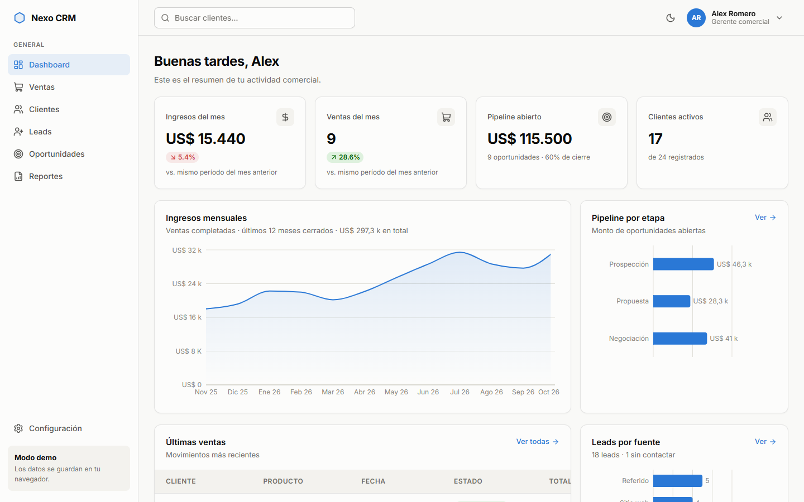
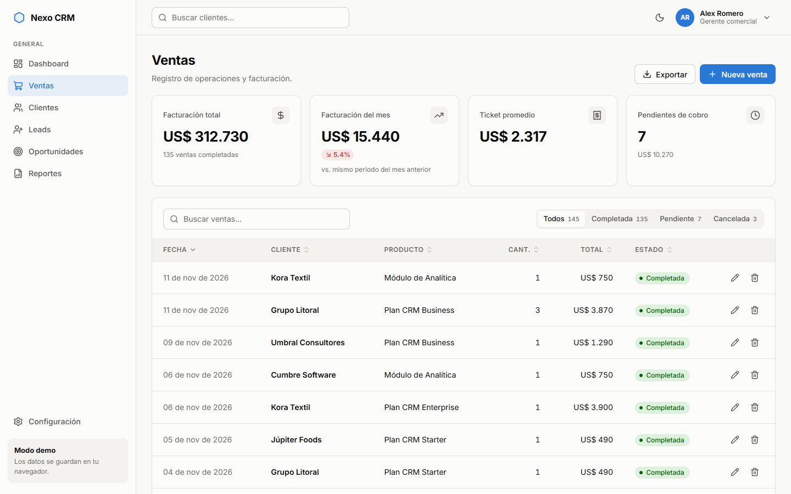
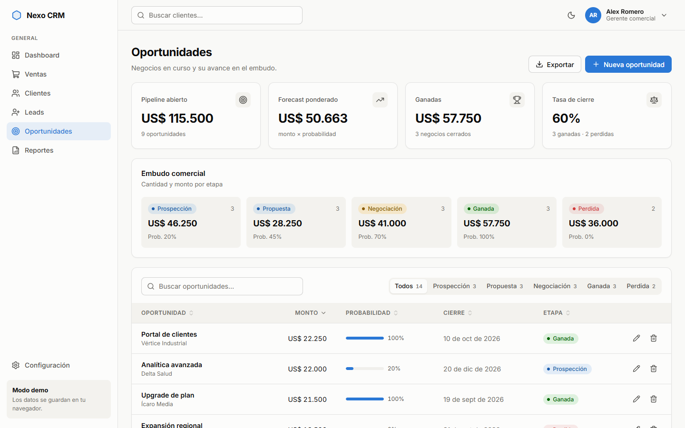
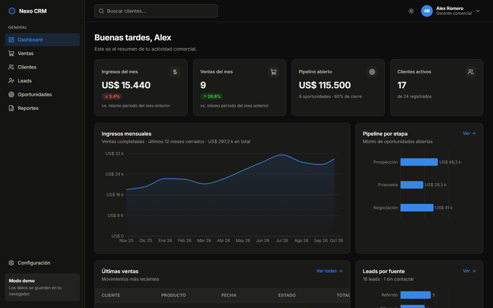
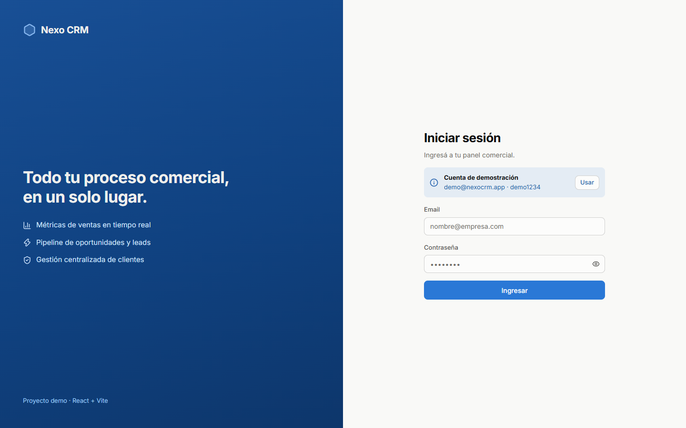
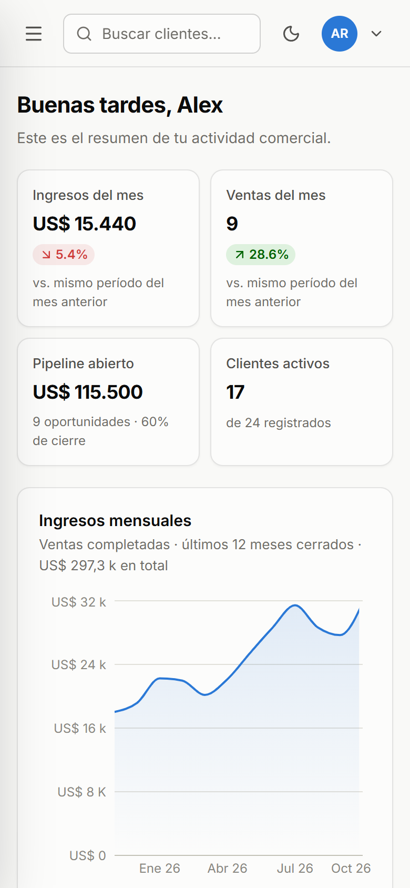

# Nexo CRM — Panel comercial

Dashboard de gestión comercial (CRM) construido con **React 19 + Vite**. Permite seguir ventas, clientes, leads, oportunidades y reportes, con métricas y gráficos calculados en tiempo real a partir de los datos.

### [▶ Ver demo en vivo](https://barbaracortez.github.io/dashboard-app/)

**Acceso demo:** `demo@nexocrm.app` / `demo1234`. La pantalla de login también tiene un botón "Usar" que completa los datos.

> Funciona sin backend: los datos de ejemplo se generan y guardan en el navegador (localStorage), así que podés crear, editar y borrar registros libremente. Desde **Configuración → Restablecer datos** volvés al estado inicial. Opcionalmente se conecta a una API REST con json-server.



<table>
  <tr>
    <td></td>
    <td></td>
  </tr>
  <tr>
    <td></td>
    <td></td>
  </tr>
</table>

<p align="center"></p>

---

## Funcionalidades

- **Dashboard** con KPIs (ingresos del mes contra el mes anterior, ventas, pipeline abierto, tasa de cierre, clientes activos), un gráfico de ingresos de los últimos 12 meses, el pipeline por etapa, los leads por fuente y las últimas ventas.
- **Módulos CRUD completos:** Ventas, Clientes, Leads, Oportunidades y Reportes, con:
  - búsqueda (sin distinguir acentos), filtros por estado con contadores, ordenamiento por columna y paginación
  - alta y edición en modal con validación, y eliminación con confirmación
  - notificaciones (toasts) y estados de carga (skeletons), vacío y error
  - exportación a **CSV** compatible con Excel
- **Embudo comercial** con monto, probabilidad y forecast ponderado.
- **Autenticación simulada** con rutas protegidas y sesión persistente.
- **Tema claro / oscuro**, que respeta la preferencia del sistema y se recuerda entre visitas.
- **Diseño responsive:** sidebar colapsable en mobile.
- **Accesibilidad:** navegación por teclado, `aria-*` en menús y modales, paleta de gráficos validada para daltonismo y soporte de `prefers-reduced-motion`.
- **Carga diferida por ruta** (code splitting) para un bundle inicial liviano.

## Stack

| Área | Tecnología |
|---|---|
| UI | React 19, CSS propio con design tokens (sin frameworks) |
| Build | Vite 6 |
| Ruteo | React Router 7 |
| Gráficos | Recharts 3 |
| Íconos | Lucide |
| API simulada | localStorage (modo demo) o json-server |
| Calidad | ESLint 9 |

## Instalación

```bash
git clone https://github.com/barbaracortez/dashboard-app.git
cd dashboard-app
npm install
npm run dev
```

Abrí http://localhost:5173.

### Usar con json-server (opcional)

```bash
npm run db:seed    # genera db.json con los datos de ejemplo
npm run server     # API en http://localhost:5000
npm run dev:api    # frontend apuntando a la API (en otra terminal)
```

La URL de la API se configura con la variable `VITE_API_URL` (ver `.env.example`).

## Scripts

| Comando | Descripción |
|---|---|
| `npm run dev` | Servidor de desarrollo (modo demo) |
| `npm run dev:api` | Desarrollo conectado a json-server |
| `npm run server` | Levanta json-server en el puerto 5000 |
| `npm run db:seed` | Regenera `db.json` |
| `npm run build` | Build de producción en `dist/` |
| `npm run preview` | Sirve el build localmente |
| `npm run lint` | Análisis estático |
| `npm run build:pages` | Build para GitHub Pages (subpath `/dashboard-app/` + un `.html` por ruta) |
| `npm run preview:pages` | Sirve ese build imitando a GitHub Pages (códigos 200/404 reales) |
| `npm run deploy` | Publica la demo en GitHub Pages |

## Estructura

```
src/
├── components/
│   ├── charts/        # Gráficos (Recharts) con tooltip y colores por tema
│   ├── ui/            # Badge, StatCard, Modal, DataTable, PageHeader
│   ├── ResourcePage   # Página CRUD genérica configurable
│   └── ResourceForm   # Formulario generado a partir de campos
├── context/           # Auth, Theme y Toast providers
├── data/seed.js       # Generador determinístico de datos de ejemplo
├── hooks/             # useCollection: carga + CRUD con notificaciones
├── layout/            # Sidebar, topbar y shell
├── pages/             # Dashboard y módulos
├── services/api.js    # Capa de datos: localStorage o API REST
├── styles/global.css  # Design tokens y estilos
└── utils/             # Formato de moneda y fechas, y métricas
```

Cada módulo se define de forma **declarativa** (columnas, campos del formulario, filtros y KPIs) sobre `ResourcePage`, lo que evita duplicar lógica entre pantallas.

## Deploy

**GitHub Pages** (deploy actual):

```bash
npm run deploy   # build con base /dashboard-app/ y publicación en la rama gh-pages
```

También está preparado para **Vercel** y **Netlify** (`vercel.json` y `public/_redirects`). Como el modo demo no necesita backend, alcanza con build command `npm run build` y output directory `dist`.
